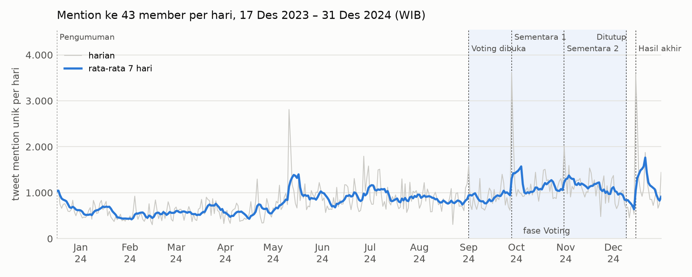
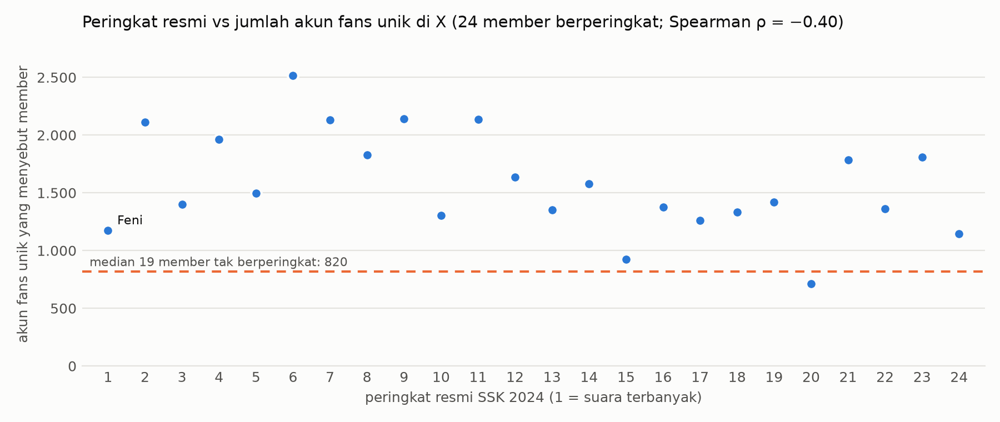

# Laporan Project Metrik X JKT48

**Penarikan data X member JKT48, mention fans, dan dataset Senbatsu Sousenkyo (SSK) 2024**

Status per 30 Oktober 2026 · disusun dari kode, data, dan log project `~/Claude/x-jkt48-metrics`

> **Catatan berbagi:** laporan ini untuk internal. Data mentah (`data_vps/`) dan sheet Tweet Member tidak boleh dibagikan apa adanya (lihat 2.5). Perbandingan antar member di bagian 7.5 jangan dikutip lepas dari konteks.

---

## Ringkasan eksekutif

- **Yang dibangun:** sistem penarik data X (Twitter) yang berjalan otomatis di VPS. Sistem ini memakai akun X cadangan dan proxy residensial, mengirim hasil ke Excel dan Telegram, dan punya dashboard harian di Railway.
- **Data yang terkumpul:**
  1. **Metrik 1 tahun 50 member** (22 Okt 2025 – 23 Okt 2026): 53.657 tweet, termasuk 35.995 post utama dengan total 1,52 miliar views (dihitung sampai 23 Okt; lihat bagian 4).
  2. **Dataset SSK 2024** (17 Des 2023 – 31 Des 2024, 43 member):
     - 60.642 tweet member
     - 367.085 baris mention (324.378 tweet unik; 295.235 di antaranya dari 12.577 akun fans unik)
     - 23.762 baris tweet hashtag kampanye
- **Temuan awal:**
  - Mention memuncak tepat di hasil sementara 1 (28 Sep 2024) dan hasil akhir (15 Des 2024).
  - Keramaian di X tidak sama dengan jumlah suara. Member berperingkat umumnya disebut lebih banyak akun fans daripada yang tidak berperingkat (median 1.459 vs 820 akun). Tapi di dalam 24 besar, urutannya hanya lemah-sedang mengikuti X (Spearman ρ = −0,40, n = 24): peringkat teratas tidak selalu disebut oleh akun fans terbanyak.
- **Status:** semua job penarikan selesai. Dataset SSK sudah diekspor ke satu file Excel dan lulus verifikasi independen. Dashboard harian masih jalan. Kode, riset, dan laporan sudah di-commit ke repo git lokal project (tanpa data mentah).
- **Langkah berikut:** model penjelas suara SSK berupa regresi tersensor. Residualnya dipakai sebagai ukuran efisiensi konversi dari dukungan di X ke suara.

---

## 1. Latar belakang dan tujuan

Project dimulai 22 Okt 2026 dari pertanyaan: *metrik X apa saja yang bisa diambil untuk member JKT48?* Tujuannya lalu berkembang menjadi tiga lapis:

1. **Gambaran publik member di X**: aktivitas posting, engagement, tren, dan interaksi antar member selama setahun.
2. **Dukungan fans**: tweet fans yang menyebut member (tanpa reply) dan hashtag kampanye fanbase.
3. **Willingness to pay (WTP)**: seberapa jauh metrik X menjelaskan kesediaan fans membayar untuk mendukung member di SSK. Suara SSK bersifat berbayar, sekitar Rp12.000 per suara menurut riset `research/01`.

Prinsip yang dipegang sepanjang project:

- **Fans individu tidak diprofilkan.** Di file ekspor (Excel/CSV), handle dan id tweet fans diganti hash; teks, link, dan jumlah follower persis tidak ditulis. Data mentah masih menyimpan id tweet asli fans, jadi tidak boleh dibagikan.
- **Interaksi fans–member satu arah.** Member JKT48 tidak membalas atau me-quote fans (kebiasaan grup, dikonfirmasi user). Karena itu faktor "balasan member ke fans" tidak dipakai dalam analisis, dan tweet member ditulis apa adanya. Member sesekali me-repost tweet akun di luar daftar member/fanbase/official (lihat 7.4).
- **Tidak membingkai member sebagai pemenang/pecundang.** Data disajikan netral. Peringkat SSK hanya dipakai sebagai label hasil resmi.

---

## 2. Arsitektur dan cara kerja

### 2.1 Sumber data

- **Agent-Reach** (github.com/Panniantong/Agent-Reach) hanya dipakai sebagai titik awal. Untuk X, ia memakai **twitter-cli 0.8.5** dengan cookie `auth_token` + `ct0` dari **akun X cadangan**.
- Penarikan utama memakai endpoint GraphQL **SearchTimeline** milik X lewat modul sendiri (`fetch_v2.py`), dengan query `from:`, `@handle`, `#hashtag`, `since:`/`until:`, dan `since_time:`/`until_time:`.
- Timeline profil dipakai untuk cek silang dan menambal tweet yang terlewat search (11 tweet Erine). Timeline tidak dipakai sebagai sumber utama karena berhenti di sekitar 840 tweet.

### 2.2 Komponen kode (± 5.300 baris Python)

| File | Peran |
|---|---|
| `fetch_v2.py` | Inti penarik: search lewat POST, pagination, jendela waktu, pecah jendela adaptif, toleran error parsial, penyimpanan JSONL + state atomik |
| `xraw.py` | Parser tweet mentah: kategori Original / Quote / Reply / Reply (thread sendiri) / Repost; anonimisasi penulis non-publik |
| `worker.py` | Batch metrik member (full1): pacer, penjaga rate limit, proxy, Telegram, kirim ulang Excel |
| `build_jobs.py` | Dataset SSK (xlsx) → `jobs/ssk2024.json`: 43 member, 127 task aktif (jendela harian 4 task mention diedit manual setelahnya) |
| `job_worker.py` + `taskqueue.py` | Worker job multi-akun dengan **antrean bersama** (klaim atomik, detak jantung, ambil alih klaim basi, ekspor sekali) |
| `export_jobs.py` | Excel ringkasan + CSV.gz di server (hemat RAM) |
| `export_dataset.py` | **Dataset lengkap satu Excel** (baris mentah), dijalankan di Mac |
| `export_combined.py`, `export_excel.py` | Excel metrik 50 member dan per member |
| `analysis.py` | Sanity check + analisis awal → `analysis/report.md` |
| `stress_test.py` | Uji batas jendela search mention |
| `daily/` | Dashboard harian (Flask + APScheduler + Google Sheets) |
| `tests/test_jobs_offline.py` | 47 cek offline dengan respons X tiruan (semua lulus) |

### 2.3 Infrastruktur

- **VPS Ubuntu 24.04** (1 vCPU, RAM 1,9 GB), service systemd:
  - `jkt48-x-worker` untuk batch member
  - `jkt48-x-job@akun1..3` untuk job SSK, satu per akun
  - `jkt48-x-stress@` untuk uji batas
  - Prioritas dibuat rendah (`Nice=10`, `CPUWeight=20`) dan memori dibatasi (`MemoryMax`), karena VPS dipakai bersama layanan lain.
- **Proxy residensial** (exit IP Indonesia) wajib dipakai (`REQUIRE_PROXY=1`). Worker menolak berjalan tanpa proxy.
- **Telegram bot:** notifikasi progres, peringatan berhenti, dan kiriman Excel.
- **Railway:** dashboard harian (`daily/`) beserta fetch harian kecilnya. Rencana awal batch di Railway dipindah ke VPS setelah Railway outage (22 Okt); insiden keamanan Railway (23 Okt) jadi pertimbangan tambahan.
- **Docker:** `Dockerfile` dan `run.sh` (`WORKER=members|jobs|stress`) tersedia tapi belum pernah diuji. `taskqueue.py` baru ditambahkan ke image setelah cek fakta laporan; sebelumnya mode `jobs` dan `stress` akan gagal.

### 2.4 Tempo dan pengaman

- **Tempo dipatok 35 request per 15 menit per proses worker**, dengan jeda acak 4–12 detik. Batas X sendiri sekitar 50 per 15 menit per akun. Saat fetch harian dashboard memakai akun yang sama dengan job SSK, satu akun bisa menerima dua kali tempo itu, dan pengamannya hanya penjaga 429.
- **Rate limit:** setiap kena 429 worker istirahat 20 menit; tiga kali 429 berturut-turut membuat worker berhenti aman (🛑).
- **Gangguan jaringan:** dicoba ulang otomatis dengan jeda bertahap 60 detik sampai 30 menit.
- **Tahan restart:** semua state disimpan atomik, jadi worker yang mati atau di-restart melanjutkan dari jendela terakhir.

### 2.5 Privasi

- **Di file ekspor** (Excel dan CSV.gz), fans individu (penulis di luar daftar member, fanbase, dan official):
  - Handle diganti hash `u_…` dan id tweet diganti hash `t_…`. Hash memakai salt rahasia per job, sehingga konsisten lintas file.
  - Teks, link, dan jumlah follower persis tidak ditulis; yang ada hanya kelompok follower.
  - Handle fans yang disebut di tweet lain dibuang.
- **Data mentah** (`data_vps/ssk2024/mention` dan `hashtag`) masih menyimpan id tweet asli fans, jumlah follower persis, dan tanggal akun dibuat. Folder ini, termasuk file salt, **tidak boleh dibagikan**.
- **Tweet member** ditulis apa adanya (keputusan user), termasuk akun yang dibalas atau di-repost member.
- **Batasnya:** anonim di ekspor berarti pseudonim. Waktu dan metrik persis tetap ada untuk analisis, sehingga tweet aslinya secara teori masih bisa dicari ulang di X. Selain itu, 22 repost member di sheet Tweet Member menunjuk tweet yang di sheet Mention/Hashtag tercatat anonim, jadi baris itu bisa dikaitkan kembali (lihat 7.4). Baris fans tidak boleh dipublikasikan satu per satu.

---

## 3. Temuan teknis tentang X

| Temuan | Penanganan |
|---|---|
| SearchTimeline lewat GET → 404 | Pakai POST |
| Cursor halaman 2+ ada di `TimelineReplaceEntry` | Parser membaca kedua jenis entri |
| Halaman pertama kadang kosong walau ada tweet | Coba ulang jendela kosong (`empty_retries`) |
| Kadang respons berisi data + error sekaligus | `_post_tolerant`: data tetap dipakai, kode 88 dianggap rate limit |
| Rate limit ±50 request / 15 menit per akun; proxy tidak menambah kuota | Pacer 35/15 menit; paralel = tambah akun, bukan tambah IP |
| Timeline profil berhenti di sekitar 840 tweet | Pakai search berjendela waktu |
| Jendela search terlalu lebar kehilangan tweet | Uji batas (24 Okt): jendela 1 hari selalu lengkap; jendela 7 hari kehilangan 1–3% saat isinya 260–300 tweet; jendela ≤180 tweet lengkap |
| Login X tidak saling mencabut antar device | Satu akun boleh dipakai paralel (VPS + Railway); efeknya hanya kuota rate limit yang terbagi |

---

## 4. Hasil 1 — Metrik 1 tahun 50 member (batch `full1`)

- **Roster:** `members.csv` berisi 58 member. 50 di antaranya punya akun X resmi; 8 lainnya (trainee) belum punya.
- **Uji 5 member (`test5`):** 561 request, selesai 23 Okt 2026 03:30 WIB.
- **Batch penuh `full1`:** mulai 23 Okt 09:07 WIB dengan 6 member yang sudah selesai dipakai ulang. Selesai 50/50 member dengan 6.564 request. Excel 8,8 MB terkirim ke Telegram 25 Okt 10:23 WIB.
- **Periode:** 22 Okt 2025 – 23 Okt 2026 (WIB). Tiap member ditarik antara 22 Okt malam dan 25 Okt pagi, jadi data 23 Okt belum lengkap untuk 23 dari 50 member. Excel full1 yang dikirim ke Telegram dan backfill dashboard ikut memuat 41 tweet tanggal 24 Okt (total 53.698 tweet, 36.029 post utama, 1,53 miliar views). Angka di bawah dipotong sampai 23 Okt.

| Jenis tweet | Jumlah |
|---|---|
| Original | 34.054 |
| Quote | 1.941 |
| Reply | 8.624 |
| Reply (thread sendiri) | 1.450 |
| Repost | 7.588 |
| **Total** | **53.657** |

**Post utama** (Original + Quote): 35.995 post, 1,52 miliar views. Repost tidak dihitung dalam engagement karena metriknya milik tweet asli.

---

## 5. Hasil 2 — Sanity check dan analisis awal

Laporan lengkap ada di `analysis/report.md`. Analisis ini dijalankan pada 6 member pertama (3.925 tweet) dan **belum diulang untuk 50 member**.

- **Sanity check:** kebersihan data, konsistensi metrik, kelengkapan mingguan, ketergantungan pada tweet viral, stabilitas dua paruh (ρ = 0,77), dan anomali rasio engagement semuanya lulus. Cakupan search baru dicek untuk 1 dari 6 member (2 hari berlubang), dan uji kejenuhan metrik belum bisa dijalankan. Ada 3 pasangan metrik yang sangat berkorelasi, jadi cukup pakai salah satu atau gabungkan jadi indeks.
- **Efek konten terhadap views** (OLS dengan efek tetap member dan bulan; n = 2.101 post; R² = 0,51):

| Faktor | Efek | Keterangan |
|---|---|---|
| Foto | **+111%** (CI 98–125%) | Signifikan setelah koreksi Holm |
| Video/GIF | **+114%** (CI 66–175%) | Signifikan; n kecil |
| Quote (vs Original) | +15% | Tidak signifikan setelah Holm (p = 0,06) |
| Teks pendek | −7% | p Holm = 0,02 |
| Jam posting | −6% s.d. +4% | Tidak signifikan setelah Holm |
| Akhir pekan | ≈ 0 | Tidak signifikan |

- **Temuan lain:**
  - Reply member sebagian besar (75–91% pada 6 member yang dicek) ditujukan ke sesama member. Sisanya ke eks-member, JKT48V, grup saudara, atau brand, bukan ke fans.
  - Median views di paruh kedua naik 1,22–1,46× pada 4 dari 6 member (satu naik 1,10×, satu turun 0,82×), sementara rasio like 0,86–1,19. Ada dugaan inflasi views platform (belum diuji), jadi perbandingan antar waktu sebaiknya memakai views yang dinormalisasi per bulan.

---

## 6. Hasil 3 — Dashboard harian

- **URL:** https://jkt48-x-metric.up.railway.app (cek `/health` 30 Okt 2026: ok).
- **Isi:** tab Ringkasan, Perbandingan, Tren, Top Post, dan Post Terbaru, plus detail per member.
  - Tren mingguan dan bulanan untuk metrik apa pun.
  - Regresi otomatis jumlah post vs metrik.
  - Mention yang diterima tiap member.
- **Pembaruan:** cron 00:00 WIB menyimpan snapshot follower harian, tweet baru, dan mention harian. Data dicerminkan ke Google Sheets "JKT48 X Metric Dataset", termasuk tab `Data` per tweet (backfill 53.698 baris, periode sampai 24 Okt 2026).
- **Gerbang kematangan:** metrik tweet baru masuk agregat setelah tweet berumur ≥7 hari. Tweet di-refetch setiap malam selama 9 hari.
- **Prinsip tampilan:** tanpa kolom peringkat atau kata "terkuat". Fandom sensitif terhadap perbandingan member.

---

## 7. Hasil 4 — Job SSK 2024

### 7.1 Cakupan dan desain

- **Sumber:** dataset `Data Set SSK 2024.xlsx` dari user, disalin ke `datasets/ssk2024.xlsx` (fanbase, tagline/hashtag, username lama).
- **Cakupan:** **43 member**, yaitu 40 member aktif ditambah 3 member yang sudah lulus tapi masuk peringkat (Gracia, Indira, Cathy). Untuk mereka, handle lama ikut dicari.
- **Periode:** 17 Des 2023 – 31 Des 2024 WIB, dibagi tiga fase:

| Fase | Tanggal |
|---|---|
| Pra-voting | 17 Des 2023 – 31 Agu 2024 |
| Voting | 1 Sep – 9 Des 2024 |
| Pasca-voting | 10 – 31 Des 2024 |

- **Tanggal penting:** pengumuman di konser "Flowerful" (17 Des 2023), hasil sementara 1 (28 Sep), hasil sementara 2 (31 Okt), voting ditutup (9 Des), hasil akhir di konser "Wonderland" (15 Des).
- **127 task:**

| Mode | Task | Query | Jendela |
|---|---|---|---|
| member | 43 | `from:handle` | mingguan |
| mention | 43 | `(@handle OR @handle_lama)` `-from:…` `-filter:replies` `-filter:nativeretweets` | harian (4 member), lalu 3 hari dengan pecah harian otomatis bila ≥120 tweet (39 member) |
| hashtag | 41 | `#TAG` `(JKT48 OR panggilan OR @member OR @fanbase)` `-filter:nativeretweets` | mingguan, pecah harian bila ≥80 tweet |
| tagline | 38 | (nonaktif — terlalu umum) | – |

### 7.2 Eksekusi

- **Tiga akun X cadangan** bekerja paralel lewat antrean bersama. Task yang sudah diklaim satu akun tidak dikerjakan akun lain.
  - akun2 dan akun3 mulai 24 Okt 2026 sekitar 10:00 WIB.
  - akun1 bergabung 25 Okt pagi, setelah batch `full1` selesai.
- **Selesai 30 Okt 2026 03:19 WIB:** 127/127 task. Excel ringkasan (172 KB) dibuat sekali oleh akun1 dan dikirim ke Telegram.
- **Beban kerja:** lebih dari 46 ribu request search: 36.728 halaman mention, 4.864 halaman hashtag, dan sekitar 4.700 request untuk 2.365 jendela member mingguan. Angka ini belum termasuk percobaan ulang.
- **Kecepatan:** sekitar **110–125 halaman per jam per akun** (rata-rata seluruh run), mendekati batas tempo 140 per jam.
- **Gangguan:** sekitar 480 kejadian gangguan jaringan dari proxy residensial (±1% request), semuanya pulih otomatis setelah jeda. **Worker tidak pernah berhenti (🛑) dan tidak ada akun yang terkena masalah.**

### 7.3 Pelajaran: jendela 3 hari

Jendela mention 3 hari dipasang untuk mempercepat job. Hasilnya beragam:

- **3 member yang mentionnya paling ramai:** 63–66% jendela 3 hari tembus ≥120 tweet sehingga harus ditarik ulang per hari, membuang **38–40% halaman**.
  - Contoh: Freya dengan jendela 3 hari menghabiskan 2.339 halaman. Christy dengan jendela harian hanya 1.687 halaman, padahal tweetnya lebih banyak.
- **3 member ramai berikutnya:** 24–44% jendela tembus, membuang 26–34% halaman.
- **Member bervolume sedang dan rendah:** pemborosannya kecil (13% pada member bervolume sedang; 0–9% pada 17 member paling sepi), jadi di sini jendela 3 hari memang menghemat.
- **Pelajaran:** ukuran jendela sebaiknya adaptif. Setelah satu jendela meluap, lanjutkan per hari sampai sepi, baru kembali ke 3 hari.

### 7.4 Dataset akhir

- **Kenapa diekspor di Mac:** VPS tidak cukup RAM untuk menulis semua baris mentah ke Excel, jadi data di-sync ke Mac dan diekspor dengan `export_dataset.py`.
- **File:** `exports/JKT48_SSK2024_dataset_lengkap.xlsx` (72,6 MB).

| Sheet | Baris | Isi |
|---|---|---|
| Baca Dulu | – | Penjelasan, aturan, kamus semua kolom |
| Ringkasan | 43 + TOTAL | Jumlah per member |
| Member | 43 | Handle sekarang/lama, fanbase, tagline |
| Task | 127 | Query, ukuran jendela, kelengkapan (0 jendela mention/hashtag terpotong) |
| Tweet Member | 60.642 | 40.645 post utama, 17.033 reply, 2.964 repost |
| Mention | 367.085 | 337.069 dari fans/akun lain, 28.838 dari fanbase; 1,09 miliar views dijumlah per baris (±0,91 miliar per tweet unik) |
| Hashtag | 23.762 | 21.178 tweet unik per member; 64,2 juta views |

**Verifikasi:**
- Angka per member cocok 100% dengan Excel ringkasan server, dan jumlah baris sama dengan CSV.gz di server.
- Tiga verifier independen menghitung ulang **setiap sel** dari data mentah (nilai, privasi, integritas file) dan semuanya lulus.
- File terbuka normal di Microsoft Excel.
- **Catatan privasi:** verifier menemukan 22 repost member (dari 10 akun) yang menunjuk tweet yang di sheet Mention/Hashtag tercatat anonim sebagai fans/akun lain. Perbaikannya dibatalkan karena, atas keputusan user, tweet member ditulis apa adanya, jadi 22 baris anonim itu bisa dikaitkan kembali. Belum dicek apakah akun-akun itu fans atau brand/eks-member.

### 7.5 Gambaran awal data



- Rata-rata ada sekitar 850 tweet mention unik per hari.
- Hari tertinggi: **28 Sep 2024** (hasil sementara 1, 3.607 tweet) dan **15 Des 2024** (hasil akhir, 3.590 tweet). Lonjakan 11 Mei 2024 (2.811 tweet) belum diidentifikasi pasti; hashtag terbanyak hari itu #jkt48springhascome (183 tweet).
- Tingkat dasar mention naik bertahap: rata-rata 567 per hari (Jan–Apr), 885 (Jun–Agu), dan 1.078 selama fase Voting.



- Member berperingkat umumnya disebut lebih banyak akun fans: median 1.459 akun, dibanding 820 akun untuk 19 member tak berperingkat. Tapi tumpang-tindihnya besar: 7 dari 19 member tak berperingkat juga di atas 900 akun, dan satu member berperingkat hanya 711 akun.
- Tapi **urutan di dalam 24 besar hanya lemah-sedang mengikuti X** (Spearman ρ = −0,40, n = 24).
- Contoh: peringkat 1 (Feni, 219.616 suara) disebut 1.174 akun fans, lebih sedikit daripada 20 dari 23 member berperingkat di bawahnya.
- Artinya, suara (uang) tidak cukup dijelaskan oleh luasnya dukungan di X saja.

---

## 8. Riset SSK dan kerangka model

Riset tersimpan di `research/01–04` (per 23 Okt 2026). Riset 01 menandai tiap klaim sebagai fakta [F] atau dugaan [D].

- **SSK 2024 menurut riset 01:**
  - [F] Hanya 24 besar yang dipublikasikan; peringkat 1 final Feni dengan 219.616 suara.
  - [F] Suara diperoleh lewat pembelian berbagai item (OFC, tiket teater, photobook digital, MnG, 2-shot, dll.). Rekap fans menghitung sekitar Rp12.000 per suara dan total biaya lebih dari Rp18 miliar.
  - [D] Total suara 24 besar sekitar 1,53 juta (dijumlahkan sendiri oleh riset).
  - [D] Suara sangat terkonsentrasi dan melonjak di akhir; Feni naik sekitar 7× dari hasil sementara 1 ke final (urutan kolom hasil sementara perlu dicek ulang).
- **Kerangka:** suara ≈ uang ≈ **luas** (berapa banyak fans) × **partisipasi** × **kedalaman** (belanja per fans).
  - Data X kemungkinan besar mengukur luas dan organisasi kampanye.
  - Kedalaman ("whale", pembeli besar) sebagian besar tak terlihat di X.
- **Model yang diusulkan** (dari diskusi 30 Okt):
  1. **Patokan:** log(suara) ~ log(akun fans unik).
  2. **Model utama:** regresi tersensor (Tobit / log-normal Bayesian). 24 member punya angka suara; 19 lainnya masuk sebagai "di bawah batas peringkat 24".
  3. **Alternatif:** Plackett–Luce untuk data peringkat.
  4. **Panel antar checkpoint:** hasil sementara 1 → 2 → final, kalau angka suara sementara tersedia.
- **Fitur kandidat** (maksimal 3–5 karena n = 43):
  - Akun fans unik di fase Pra-voting
  - Mention per akun
  - Porsi fans yang hanya menyebut satu member
  - Volume dan akun unik hashtag kampanye
  - Lonjakan aktivitas Voting dibanding Pra-voting
  - Median like post member di fase Pra-voting
- **Keluaran utama:** residual alias **efisiensi konversi (CEI)**, yaitu member yang suaranya di atas atau di bawah sinyal X. Residual lalu dicek dengan proxy uang lain: permintaan tiket exclusive (stockcheckerv2), gift SHOWROOM, donasi fanbase.
- **Jebakan yang dijaga:**
  - Sampel kecil, jadi validasi dengan leave-one-out (latih tanpa satu member, tebak member itu).
  - Follower dan like diambil 2026, bukan 2024, jadi ada risiko bocor informasi dari masa depan. Pakai hitungan aktivitas yang bertanggal.
  - Sebab-akibat bisa terbalik, jadi pakai fitur Pra-voting.
  - Bot, sehingga perlu cek umur akun dan konsentrasi mention.
- **Etika:** jangan publikasikan daftar member dengan "konversi rendah".

---

## 9. Kendala dan pelajaran

| Kejadian | Pelajaran |
|---|---|
| Railway outage (22 Okt), lalu insiden keamanan Railway (23 Okt) | Batch dipindah ke VPS sendiri; Railway hanya untuk dashboard dan fetch harian kecil (memakai cookie akun X cadangan dan proxy, jadi secret perlu dirotasi bila ada insiden lagi) |
| Perintah yang tampak "ditolak" ternyata tetap berjalan di server | Selalu cek ulang keadaan server sebelum menyimpulkan |
| Cookie akun2 sempat identik dengan akun1 | Verifikasi identitas akun (`whoami`) sebelum menjalankan |
| Ekspor Excel di VPS kekurangan RAM | Ringkasan di VPS; dataset baris mentah diekspor di Mac |
| Estimasi selesai SSK meleset (jendela 3 hari) | Simulasi pakai member yang volumenya rendah tidak mewakili member yang ramai |
| Deploy dashboard saat fetch berjalan membuat data hari itu tidak lengkap | Jangan deploy saat cron atau `/refresh` berjalan |
| `seed.tgz` dari `tar` macOS ikut file AppleDouble | Pakai Python `tarfile` atau `COPYFILE_DISABLE=1` |
| Repost member atas tweet akun non-publik membuka anonimitas 22 baris fans (ditemukan verifier) | Perbaikan dibatalkan karena tweet member ditulis apa adanya (keputusan user); dataset jangan dibagikan mentah |
| Dockerfile tidak menyalin `taskqueue.py` (ditemukan saat cek fakta laporan) | Sudah ditambahkan ke Dockerfile (30 Okt); Docker tetap belum pernah diuji |

---

## 10. Status saat ini dan langkah berikutnya

**Status (30 Okt 2026):**
- `full1` dan job SSK2024 selesai.
- Dataset SSK lengkap sudah ada di `exports/`.
- Dashboard harian live dengan fetch harian aktif.
- 4 worker X di VPS aktif tapi menganggur.
- Kode, riset, dan laporan sudah di-commit ke repo git lokal `x-jkt48-metrics`. Data mentah, salt hash, dan hasil ekspor sengaja dikecualikan.

**Langkah berikutnya (diurutkan):**
1. Ambil angka suara final (dan sementara, kalau ada) dari tweet @officialJKT48 di data mention, lalu bangun model patokan dan model tersensor (bagian 8).
2. Ulangi `analysis.py` untuk 50 member (saat ini baru 6 member).
3. Tambal hashtag yang kemungkinan terlewat, misalnya varian tanpa aksen #BLUME untuk Lily (task #BLUMÉ hanya menghasilkan 2 tweet).
4. Uji konvergen: fans inti di X vs permintaan tiket exclusive (stockcheckerv2) vs SHOWROOM.
5. Matikan atau jeda worker yang menganggur di VPS.
6. Nanti: metrik publik Instagram dan TikTok lewat OpenCLI (desktop, akun cadangan, tanpa mention fans).

---

## Lampiran A — Lokasi data

| Data | Lokasi |
|---|---|
| Data mentah full1 (50 member) | `data_vps/*_v2.json` (+ salinan di VPS) |
| Data mentah SSK 2024 (**jangan dibagikan:** berisi id tweet asli fans dan salt hash) | `data_vps/ssk2024/` (member, mention, hashtag, state, queue, exports CSV.gz, `job_ssk2024.json`) |
| Dataset SSK lengkap (Excel) | `exports/JKT48_SSK2024_dataset_lengkap.xlsx` |
| Excel ringkasan SSK dari server | `data_vps/ssk2024/JKT48_ssk2024_antrean_72f03ba3_20261030.xlsx` |
| Analisis awal | `analysis/report.md` |
| Riset SSK | `research/01–04_*.md` |
| Sampel mention (Feni, Indah, Delynn) | `samples/sampel_mention_Feni_Indah_Delynn.xlsx` |

## Lampiran B — Menjalankan ulang

```bash
# ekspor ulang dataset SSK lengkap (Mac, ± 1 menit)
uv run --python 3.12 --with openpyxl==3.1.5 \
  python export_dataset.py \
  data_vps/ssk2024/job_ssk2024.json \
  data_vps/ssk2024 \
  exports/JKT48_SSK2024_dataset_lengkap.xlsx

# tes offline sistem job (tanpa request ke X)
uv run --python 3.12 --with openpyxl==3.1.5 \
  --with twitter-cli==0.8.5 \
  python tests/test_jobs_offline.py

# bangun ulang PDF laporan ini
uv run --python 3.12 --with markdown \
  python report/build_pdf.py report/laporan_project_x_jkt48.md

# status worker (dijalankan di VPS)
systemctl status jkt48-x-job@akun1 \
  jkt48-x-job@akun2 jkt48-x-job@akun3
```

## Lampiran C — Istilah

- **Post utama:** tweet Original + Quote milik member (dasar metrik engagement).
- **Mention:** tweet orang lain yang menyebut @member, tanpa reply dan retweet polos. Quote ikut dihitung.
- **Akun fans unik:** jumlah hash penulis berbeda dengan jenis "fans/akun lain".
- **ER (engagement rate):** (like + retweet + reply + quote) ÷ views.
- **Jendela:** potongan waktu satu pencarian. Jendela yang meluap dipecah lebih kecil.
- **CEI:** residual model suara, yaitu seberapa jauh suara melebihi atau di bawah sinyal X.
